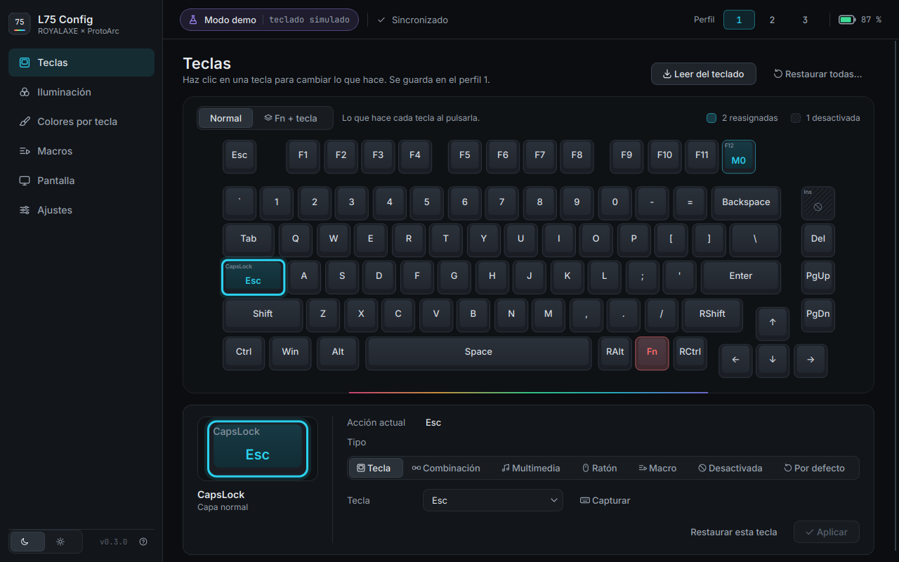
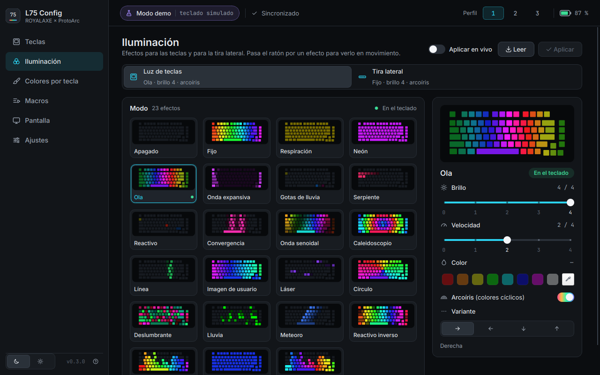
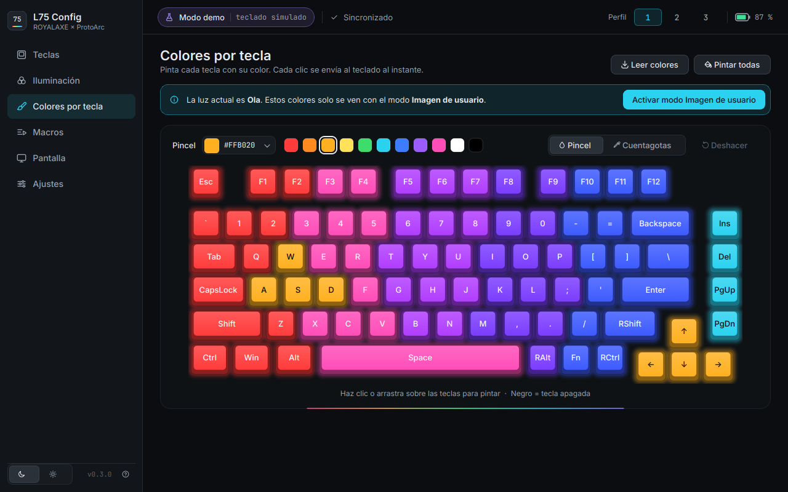
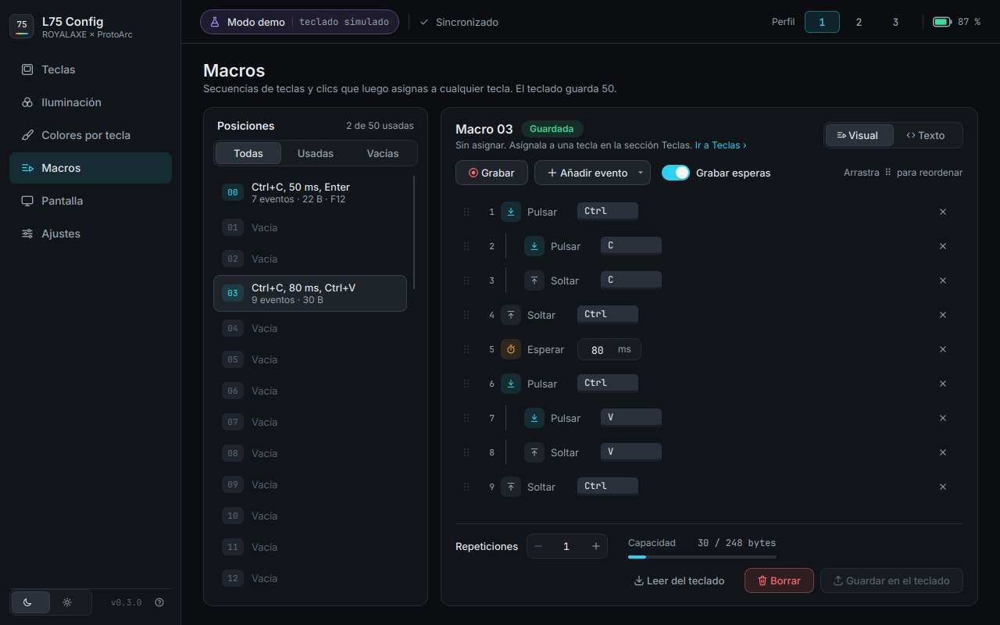
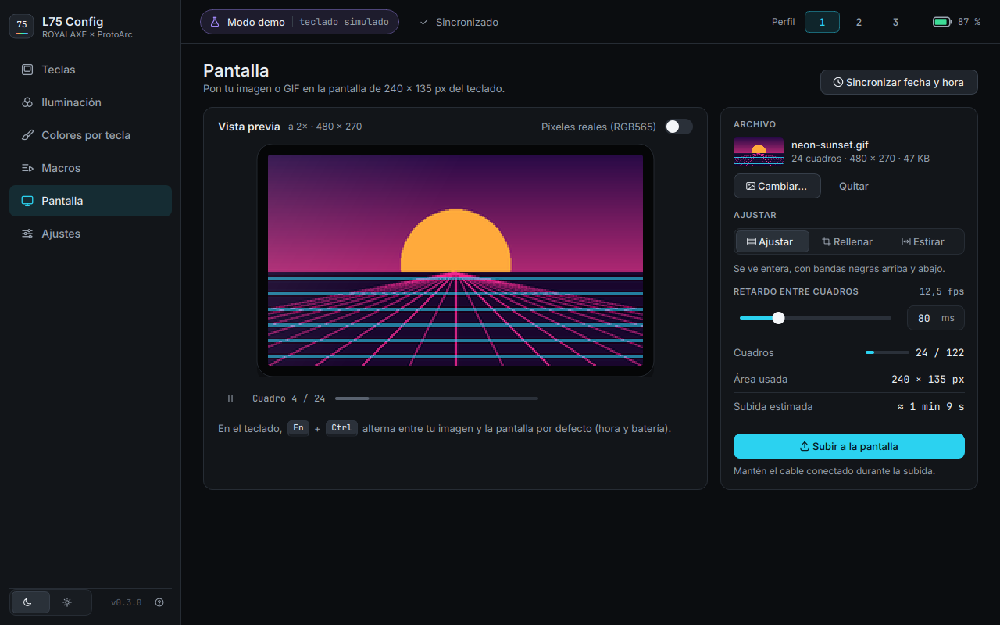
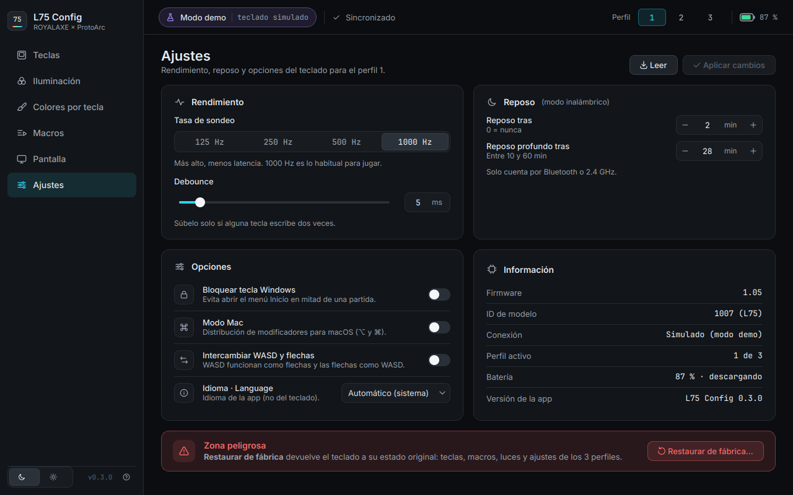
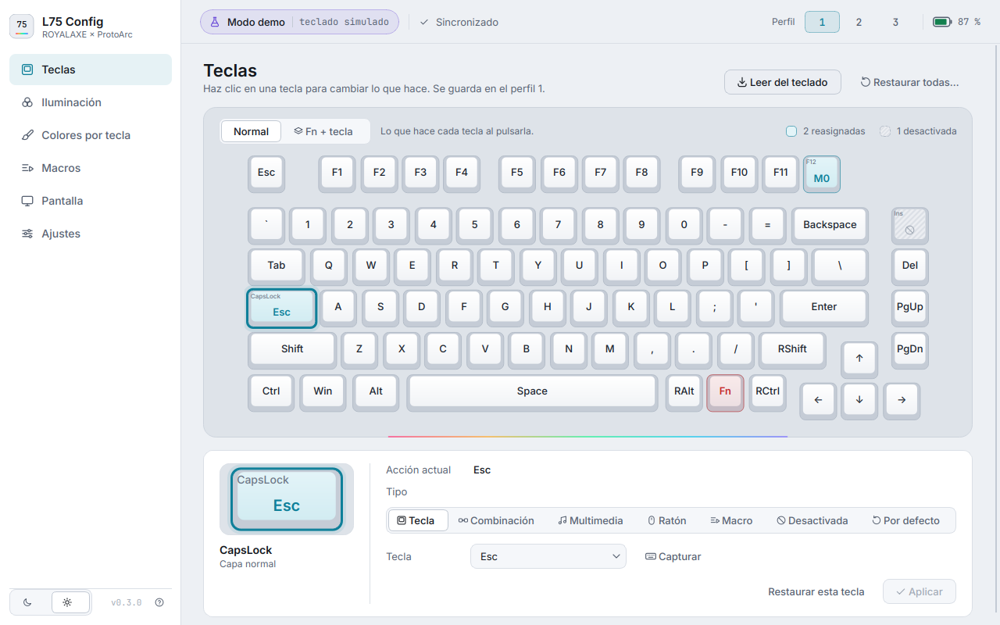

# L75 Config: configurador del ROYALAXE / ProtoArc L75

[English](README.md) · **Español**

Aplicación libre (interfaz gráfica y línea de comandos) para configurar el teclado
**ROYALAXE × ProtoArc L75** en Linux, Windows y macOS, sin el driver oficial.

> Estado: **v0.3. Probado con un L75 real por Bluetooth** (lectura de estado, luces y teclas, y
> escritura de luz verificada). **Por cable todavía sin probar.** El protocolo se obtuvo leyendo el
> driver oficial (ver [docs/PROTOCOL.md](docs/PROTOCOL.md), en inglés) y está cubierto por pruebas
> automáticas y un teclado simulado. La primera vez que lo conectes, prueba primero los comandos de solo
> lectura (`l75 info`) y después cambios pequeños.



<details><summary>Más capturas (iluminación, colores por tecla, macros, pantalla, ajustes, tema claro)</summary>








</details>

Manual oficial del teclado: [L75_User_Manual.pdf](https://cdn.shopify.com/s/files/1/0551/3972/9497/files/L75_User_Manual.pdf) (ProtoArc).

**Idiomas:** inglés y español. Por defecto la app sigue el idioma del sistema; puedes cambiarlo en
**Ajustes → Idioma**, o con `--lang en|es` en la línea de comandos.

**Plataformas:** desarrollado y probado en Linux. Hay paquetes para Windows y macOS, todavía sin probar
con el teclado.

## Qué hace

| Función | GUI | CLI |
|---|---|---|
| Reasignar teclas (tecla, combinación, multimedia, ratón, macro, desactivar), 3 perfiles + capa Fn | ✅ | `l75 keys` |
| Iluminación de las teclas: 23 efectos, brillo, velocidad, color y arcoíris | ✅ | `l75 light` |
| Tira de luz lateral | ✅ | `l75 side` |
| Colores por tecla (modo «imagen de usuario») | ✅ | – |
| Macros (50 posiciones), con editor visual y grabación | ✅ | `l75 macro` |
| Pantalla: subir imagen o GIF animado (240×135, hasta 122 cuadros) | ✅ | `l75 lcd upload` |
| Pantalla: sincronizar fecha y hora | ✅ | `l75 lcd time` |
| Tasa de sondeo, debounce, tiempo de reposo, bloqueo de Win, modo Mac, WASD↔flechas | ✅ | `l75 settings` |
| Restaurar valores de fábrica | ✅ | `l75 reset` |

**Conexión:** por **cable USB-C** o por **Bluetooth** (`L75 BT5.0`). Por defecto usa el cable si está
conectado y, si no, el Bluetooth. Puedes forzarlo con `--via usb` o `--via bt`.
Por Bluetooth funciona todo **menos subir imágenes a la pantalla**, que solo va por cable (igual que en
el driver oficial). La hora sí se puede sincronizar por Bluetooth.
El receptor 2.4 GHz todavía no está soportado.

En la **capa Fn**, las funciones del sistema del teclado (canales Bluetooth, distribución iOS/Mac/Windows,
controles de luz, pantalla, reset…) se muestran con su nombre real y bloqueadas en rojo, como en el driver
oficial.

## Descargas

En [Releases](https://github.com/GiomarOsorio/l75-config/releases) están los paquetes de cada versión:

| Sistema | Archivo | Cómo instalar |
|---|---|---|
| Windows 10/11 (64 bits) | `L75_Config-<versión>-Setup.exe` | Ejecútalo. Si SmartScreen avisa (no está firmado): «Más información» → «Ejecutar de todas formas». |
| macOS 11+ (Apple Silicon) | `L75_Config-<versión>-macOS-arm64.dmg` | Arrastra la app a Aplicaciones. La primera vez: clic derecho → «Abrir» (no está firmada por Apple). |
| Linux (cualquier distro) | `L75_Config-<versión>-x86_64.AppImage` | `chmod +x L75_Config-*.AppImage` y ejecútalo. |
| Linux (Flatpak) | `L75_Config-<versión>-x86_64.flatpak` | `flatpak install --user L75_Config-*.flatpak` y ábrelo desde el menú. |

**En Linux, además, una sola vez:** instala la regla udev para poder usar el teclado sin ser root (ni el
AppImage ni el Flatpak pueden instalarla solos):

```bash
curl -fsSL https://raw.githubusercontent.com/GiomarOsorio/l75-config/main/udev/70-royalaxe-l75.rules \
  | sudo tee /etc/udev/rules.d/70-royalaxe-l75.rules
sudo udevadm control --reload-rules && sudo udevadm trigger
```

Los paquetes se generan con GitHub Actions ([.github/workflows/build.yml](.github/workflows/build.yml)):
en Actions → «Paquetes» → «Run workflow», o al subir una etiqueta `vX.Y.Z`. Para generarlos a mano, mira
[packaging/](packaging/) (PyInstaller + Inno Setup en Windows, `build_dmg.sh` en macOS,
`build_appimage.sh` y el manifiesto Flatpak en Linux).

## Instalación desde el código (Fedora / Nobara)

```bash
sudo dnf install python3-hid hidapi python3-pyside6 python3-pillow   # si falta algo
./install.sh
```

`install.sh` hace tres cosas:
1. instala la regla udev `udev/70-royalaxe-l75.rules` (pide `sudo`), que permite usar el teclado sin ser root;
2. crea el comando `l75` en `~/.local/bin`;
3. añade «L75 Config» al menú de aplicaciones.

Después de instalar la regla, **desconecta y vuelve a conectar** el teclado.

Sin instalar nada, también puedes ejecutarlo directamente desde esta carpeta: `./l75`.

En otros sistemas: `pip install PySide6-Essentials Pillow hidapi` y ejecuta `python3 -m l75ctl`.

## Uso

### Interfaz gráfica
```bash
l75                # o ./l75, o «L75 Config» en el menú
l75 --demo gui     # probar la app SIN teclado (teclado simulado)
```

La interfaz sigue el diseño de [docs/design/](docs/design/HANDOFF.md): barra lateral con las seis
secciones, barra superior con la conexión, el perfil y la batería, tema oscuro y claro (botón abajo a
la izquierda) y avisos que no bloquean la ventana. Por debajo de 1100 px de ancho la barra lateral se
compacta a solo iconos.

### Línea de comandos
```bash
l75 list                                   # ¿se detecta el teclado?
l75 info                                   # firmware, perfil, luces...

# Luces
l75 light modes                            # lista de efectos
l75 light set wave -o left -s 3 --rainbow
l75 light set static -c "#ff8800" -b 3
l75 side set breath -c azul

# Teclas
l75 keys names                             # nombres de teclas y funciones
l75 keys set CapsLock Esc
l75 keys set F1 combo:ctrl+shift+t
l75 keys set RAlt fn:play
l75 keys set 4 fn:vol+ --fn                # Fn + 4 = subir volumen
l75 keys set CapsLock default              # restaurar
l75 --profile 2 keys list                  # ver asignaciones del perfil 2

# Macros
l75 macro set 0 "down:ctrl, tap:c, up:ctrl, delay:50, tap:enter"
l75 keys set F12 macro:0                   # macro:0:hold  /  macro:0:toggle
l75 macro get 0

# Pantalla
l75 lcd time                               # sincronizar hora
l75 lcd upload gato.gif                    # subir GIF (--fit cover para recortar)
l75 lcd upload foto.png --preview p.png    # solo generar vista previa 240x135

# Ajustes
l75 settings --report-rate 1000 --debounce 5 --win-lock on
```

Opciones globales útiles:
- `--demo`: usa un teclado simulado. No toca el hardware.
- `--dry-run`: no envía nada, muestra los paquetes en hexadecimal que se enviarían.
- `--lang en|es`: idioma de los mensajes.

En el teclado, **Fn + Ctrl** cambia la pantalla entre tu imagen y el estilo por defecto.

## Seguridad

- La app **nunca** envía comandos de actualización de firmware ni de bootloader. Están bloqueados
  en el código (`protocol.FORBIDDEN_CMDS`).
- Las teclas con funciones del sistema en la capa Fn no se pueden cambiar (igual que en el driver oficial).
- Si algo queda raro: `l75 reset` (o «Restaurar de fábrica» en Ajustes) devuelve el teclado a su
  estado original. También puedes usar la combinación de reset del manual (Fn + Esc).

## Solución de problemas

| Problema | Solución |
|---|---|
| «No encuentro el L75» | Cable: conectado y con el interruptor en modo cable (`lsusb` debe mostrar `3151:4015`). Bluetooth: emparejado y conectado como «L75 BT5.0». `l75 list` muestra lo que se detecta. |
| Por Bluetooth tarda | Es normal: cada comando BT tarda unos 70 ms. Leer todas las teclas tarda 1 o 2 s. |
| «No pude abrir … permiso» | Instala la regla udev (ver arriba) y reconecta el teclado (por Bluetooth: desconéctalo y vuelve a conectarlo). |
| La pantalla no responde al subir | Enciende la pantalla (Fn + Ctrl) y reintenta. |
| La imagen tarda | Un GIF largo son miles de paquetes. Recorta o usa menos cuadros. |

## Pruebas

```bash
python3 -m unittest discover -s tests -v
```

## Estructura

```
l75ctl/
  protocol.py   comandos, checksum, constantes
  transport.py  HID (hidapi), simulado (demo), dry-run
  keyboard.py   API de alto nivel (clase L75)
  keymap.py     teclas físicas, acciones (4 bytes), nombres HID, funciones del sistema de la capa Fn
  lighting.py   efectos de luz
  macros.py     codificación de macros
  lcd.py        imagen/GIF → RGB565 → paquetes
  i18n.py       traducciones (textos en inglés; catálogo español en i18n_es.py)
  cli.py        línea de comandos
  gui.py        punto de entrada de la interfaz gráfica
  ui/           interfaz (PySide6): tema (tokens → QSS), componentes, teclado dibujado,
                vistas previas de luz y una página por sección (ui/pages/)
  assets/       tokens del diseño, iconos SVG, icono de la app y fuentes Inter y JetBrains Mono (OFL)
  l75_data.py   matriz por defecto, layout y capa Fn (del driver y de un L75 real)
packaging/             PyInstaller, instalador de Windows, DMG, AppImage y Flatpak
.github/workflows/     compilación de los paquetes en GitHub Actions
docs/PROTOCOL.md       protocolo USB y Bluetooth (en inglés)
docs/DESIGN_BRIEF.md   brief para el rediseño visual (Claude Design)
docs/design/           entrega de Claude Design: capturas, tokens, iconos y guía (HANDOFF.md)
```

Para añadir o corregir traducciones, edita `l75ctl/i18n_es.py`; `tests/test_i18n.py` comprueba que no
falte ninguna.

## Licencia

[GPL-3.0](LICENSE). Puedes usar, modificar y redistribuir este programa; las versiones modificadas
que distribuyas deben seguir siendo libres bajo la misma licencia.

Proyecto no oficial, sin relación con ProtoArc ni ROYALAXE.

Las fuentes incluidas en `l75ctl/assets/fonts/` (Inter y JetBrains Mono) tienen su propia licencia,
SIL Open Font License 1.1; los textos están junto a los archivos.
