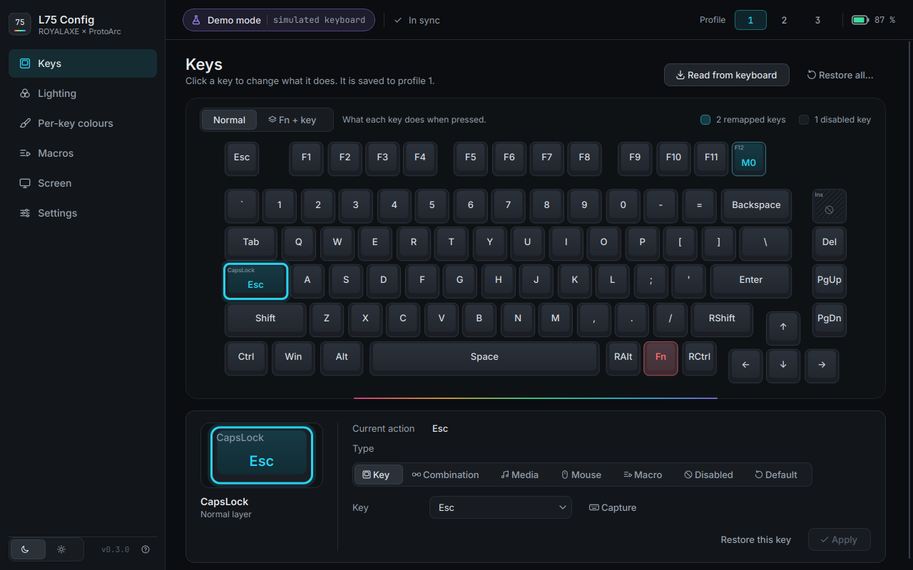
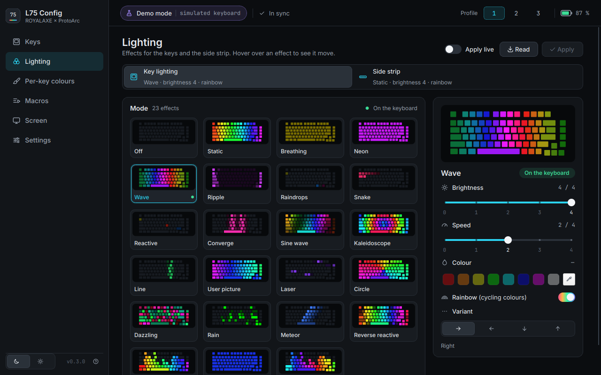
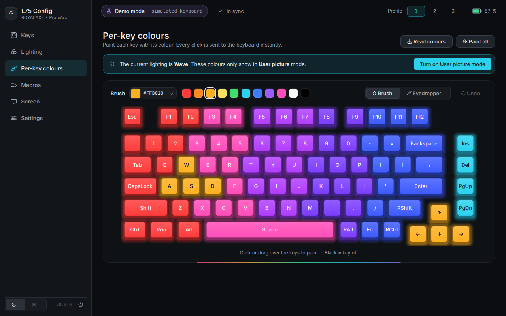
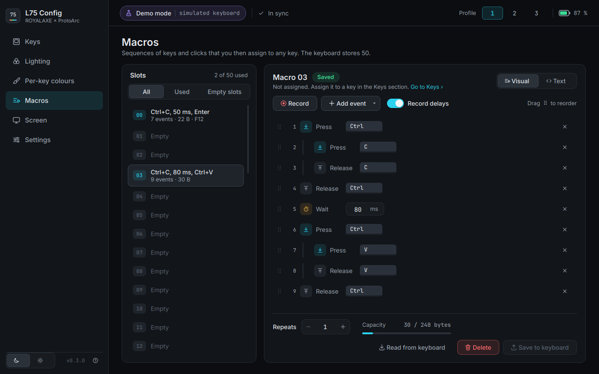
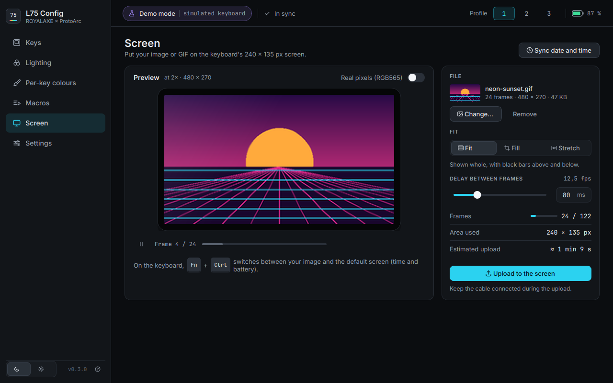
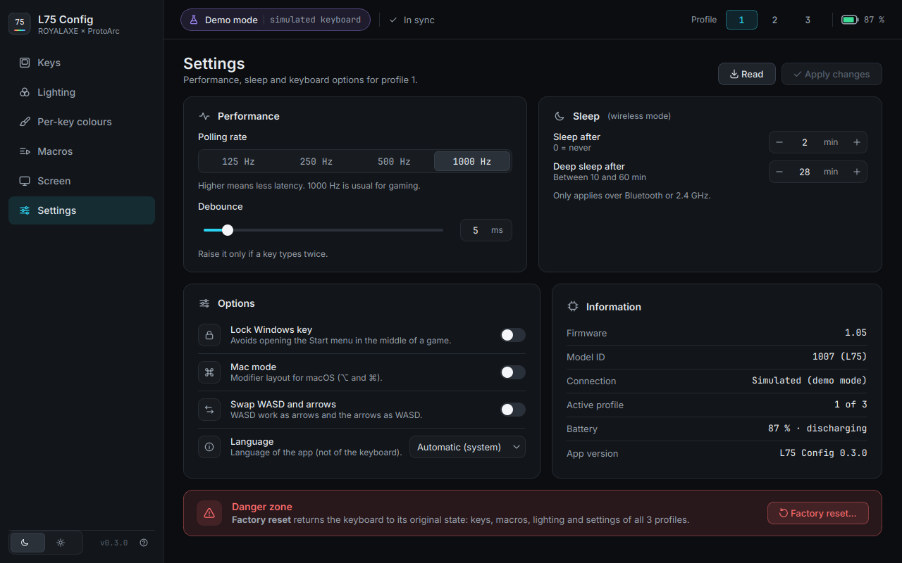
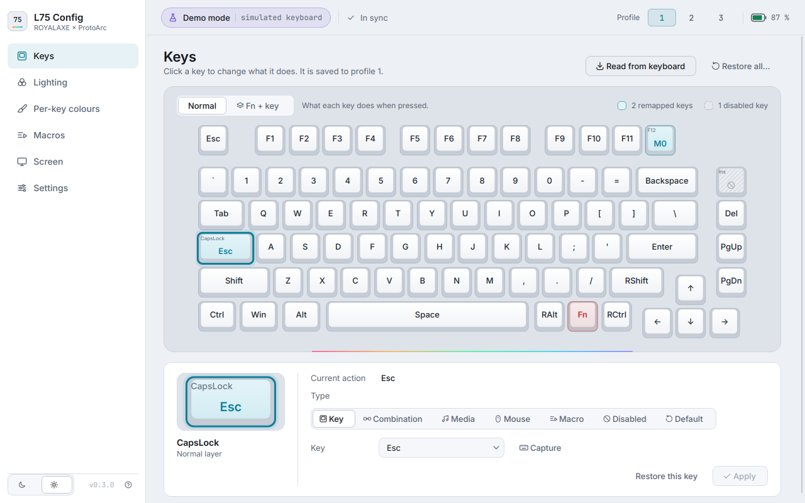

# L75 Config: configurator for the ROYALAXE / ProtoArc L75

**English** · [Español](README.es.md)

Free app (graphical interface and command line) to configure the **ROYALAXE × ProtoArc L75**
keyboard on Linux, Windows and macOS, without the official driver.

> Status: **v0.3. Tested with a real L75 over Bluetooth** (reading status, lighting and keys, and
> writing lighting verified). **The cable connection is not tested yet.** The protocol was obtained by
> reading the official driver (see [docs/PROTOCOL.md](docs/PROTOCOL.md)) and is covered by automated
> tests and a simulated keyboard. The first time you connect it, try the read-only commands first
> (`l75 info`) and then small changes.



<details><summary>More screenshots (lighting, per-key colours, macros, screen, settings, light theme)</summary>








</details>

Official keyboard manual: [L75_User_Manual.pdf](https://cdn.shopify.com/s/files/1/0551/3972/9497/files/L75_User_Manual.pdf) (ProtoArc).

**Languages:** English and Spanish. By default the app follows the system language; you can change it in
**Settings → Language**, or with `--lang en|es` on the command line.

**Platforms:** developed and tested on Linux. There are packages for Windows and macOS too, not tested
on real hardware yet.

## What it does

| Feature | GUI | CLI |
|---|---|---|
| Remap keys (key, combination, media, mouse, macro, disable), 3 profiles + Fn layer | ✅ | `l75 keys` |
| Key lighting: 23 effects, brightness, speed, colour and rainbow | ✅ | `l75 light` |
| Side light strip | ✅ | `l75 side` |
| Per-key colours ("user picture" mode) | ✅ | – |
| Macros (50 slots), with a visual editor and recording | ✅ | `l75 macro` |
| Screen: upload an image or animated GIF (240×135, up to 122 frames) | ✅ | `l75 lcd upload` |
| Screen: sync date and time | ✅ | `l75 lcd time` |
| Polling rate, debounce, sleep time, Windows-key lock, Mac mode, WASD↔arrows | ✅ | `l75 settings` |
| Factory reset | ✅ | `l75 reset` |

**Connection:** by **USB-C cable** or by **Bluetooth** (`L75 BT5.0`). By default it uses the cable if it is
connected and Bluetooth otherwise. You can force it with `--via usb` or `--via bt`.
Over Bluetooth everything works **except uploading images to the screen**, which only works by cable (same
as the official driver). The time can be synced over Bluetooth.
The 2.4 GHz receiver is not supported yet.

In the **Fn layer**, the keyboard's system functions (Bluetooth channels, iOS/Mac/Windows layout, lighting
controls, screen, reset…) are shown with their real names and locked in red, like in the official driver.

## Downloads

Every version's packages are in [Releases](https://github.com/GiomarOsorio/l75-config/releases):

| System | File | How to install |
|---|---|---|
| Windows 10/11 (64-bit) | `L75_Config-<version>-Setup.exe` | Run it. If SmartScreen warns (it is not signed): "More info" → "Run anyway". |
| macOS 11+ (Apple Silicon) | `L75_Config-<version>-macOS-arm64.dmg` | Drag the app to Applications. The first time: right click → "Open" (not signed by Apple). |
| Linux (any distro) | `L75_Config-<version>-x86_64.AppImage` | `chmod +x L75_Config-*.AppImage` and run it. |
| Linux (Flatpak) | `L75_Config-<version>-x86_64.flatpak` | `flatpak install --user L75_Config-*.flatpak` and open it from the menu. |

**On Linux, also, once:** install the udev rule so you can use the keyboard without being root (neither the
AppImage nor the Flatpak can install it themselves):

```bash
curl -fsSL https://raw.githubusercontent.com/GiomarOsorio/l75-config/main/udev/70-royalaxe-l75.rules \
  | sudo tee /etc/udev/rules.d/70-royalaxe-l75.rules
sudo udevadm control --reload-rules && sudo udevadm trigger
```

The packages are built with GitHub Actions ([.github/workflows/build.yml](.github/workflows/build.yml)):
in Actions → "Paquetes" → "Run workflow", or by pushing a `vX.Y.Z` tag. To build them by hand, see
[packaging/](packaging/) (PyInstaller + Inno Setup on Windows, `build_dmg.sh` on macOS,
`build_appimage.sh` and the Flatpak manifest on Linux).

## Installing from source (Fedora / Nobara)

```bash
sudo dnf install python3-hid hidapi python3-pyside6 python3-pillow   # if something is missing
./install.sh
```

`install.sh` does three things:
1. installs the udev rule `udev/70-royalaxe-l75.rules` (asks for `sudo`), which lets you use the keyboard
   without being root;
2. creates the `l75` command in `~/.local/bin`;
3. adds "L75 Config" to the applications menu.

After installing the rule, **unplug and reconnect** the keyboard.

You can also run it straight from this folder without installing anything: `./l75`.

On other systems: `pip install PySide6-Essentials Pillow hidapi` and run `python3 -m l75ctl`.

## Usage

### Graphical interface
```bash
l75                # or ./l75, or "L75 Config" in the menu
l75 --demo gui     # try the app WITHOUT a keyboard (simulated keyboard)
```

The interface follows the design in [docs/design/](docs/design/HANDOFF.md): a sidebar with the six
sections, a top bar with the connection, profile and battery, dark and light themes (button at the bottom
left) and notifications that do not block the window. Below 1100 px wide the sidebar collapses to icons.

### Command line
```bash
l75 list                                   # is the keyboard detected?
l75 info                                   # firmware, profile, lighting...

# Lighting
l75 light modes                            # list of effects
l75 light set wave -o left -s 3 --rainbow
l75 light set static -c "#ff8800" -b 3
l75 side set breath -c blue

# Keys
l75 keys names                             # key and function names
l75 keys set CapsLock Esc
l75 keys set F1 combo:ctrl+shift+t
l75 keys set RAlt fn:play
l75 keys set 4 fn:vol+ --fn                # Fn + 4 = volume up
l75 keys set CapsLock default              # restore
l75 --profile 2 keys list                  # show the assignments of profile 2

# Macros
l75 macro set 0 "down:ctrl, tap:c, up:ctrl, delay:50, tap:enter"
l75 keys set F12 macro:0                   # macro:0:hold  /  macro:0:toggle
l75 macro get 0

# Screen
l75 lcd time                               # sync the time
l75 lcd upload cat.gif                     # upload a GIF (--fit cover to crop)
l75 lcd upload photo.png --preview p.png   # only generate a 240x135 preview

# Settings
l75 settings --report-rate 1000 --debounce 5 --win-lock on
```

Useful global options:
- `--demo`: uses a simulated keyboard. It does not touch the hardware.
- `--dry-run`: sends nothing; prints the hex packets that would be sent.
- `--lang en|es`: language of the messages.

On the keyboard, **Fn + Ctrl** switches the screen between your image and the default style.

## Safety

- The app **never** sends firmware-update or bootloader commands. They are blocked in the code
  (`protocol.FORBIDDEN_CMDS`).
- Keys with system functions in the Fn layer cannot be changed (same as in the official driver).
- If something looks wrong: `l75 reset` (or "Factory reset" in Settings) returns the keyboard to its
  original state. You can also use the reset combination from the manual (Fn + Esc).

## Troubleshooting

| Problem | Solution |
|---|---|
| "L75 not found" | Cable: plugged in and with the switch in wired mode (`lsusb` must show `3151:4015`). Bluetooth: paired and connected as "L75 BT5.0". `l75 list` shows what is detected. |
| Bluetooth is slow | That is normal: each Bluetooth command takes about 70 ms. Reading every key takes 1 to 2 s. |
| "Could not open … permission" | Install the udev rule (see above) and reconnect the keyboard (over Bluetooth: disconnect and connect it again). |
| The screen does not answer when uploading | Turn the screen on (Fn + Ctrl) and retry. |
| The image takes long | A long GIF is thousands of packets. Trim it or use fewer frames. |

## Tests

```bash
python3 -m unittest discover -s tests -v
```

## Structure

```
l75ctl/
  protocol.py   commands, checksum, constants
  transport.py  HID (hidapi), simulated (demo), dry-run
  keyboard.py   high-level API (L75 class)
  keymap.py     physical keys, actions (4 bytes), HID names, Fn-layer system functions
  lighting.py   lighting effects
  macros.py     macro encoding
  lcd.py        image/GIF → RGB565 → packets
  i18n.py       translations (English source, Spanish catalog in i18n_es.py)
  cli.py        command line
  gui.py        entry point of the graphical interface
  ui/           interface (PySide6): theme (tokens → QSS), components, drawn keyboard,
                lighting previews and one page per section (ui/pages/)
  assets/       design tokens, SVG icons, app icon and the Inter and JetBrains Mono fonts (OFL)
  l75_data.py   default matrix, layout and Fn layer (from the driver and a real L75)
packaging/             PyInstaller, Windows installer, DMG, AppImage and Flatpak
.github/workflows/     package builds on GitHub Actions
docs/PROTOCOL.md       USB and Bluetooth protocol
docs/DESIGN_BRIEF.md   brief for the visual redesign (Claude Design)
docs/design/           Claude Design deliverable: screenshots, tokens, icons and guide (HANDOFF.md)
```

## License

[GPL-3.0](LICENSE). You can use, modify and redistribute this program; modified versions you distribute
must stay free under the same license.

Unofficial project, not affiliated with ProtoArc or ROYALAXE.

The fonts in `l75ctl/assets/fonts/` (Inter and JetBrains Mono) have their own license, the SIL Open
Font License 1.1; the texts are next to the files.
