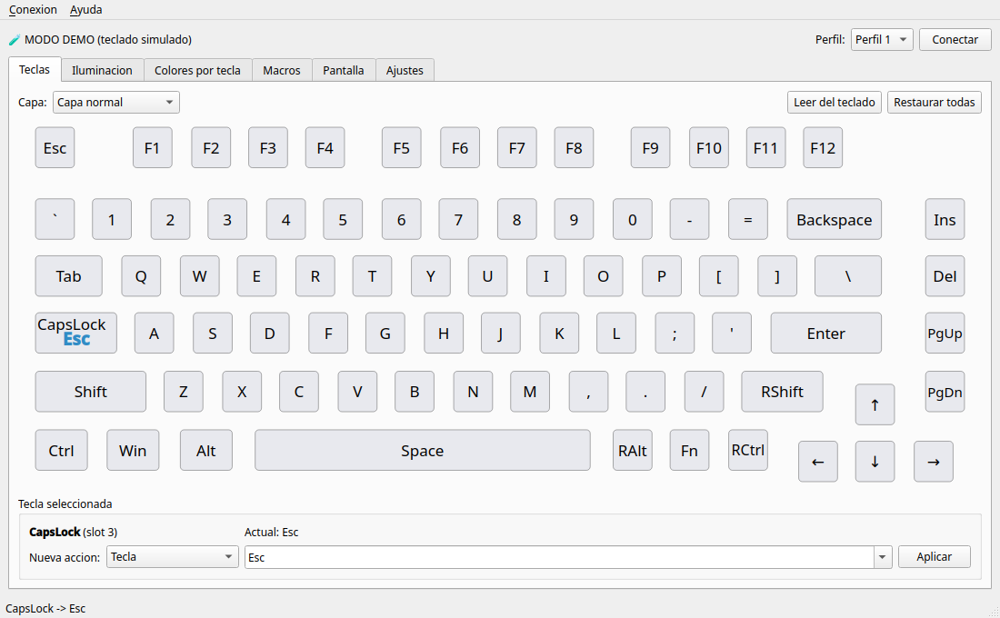

# L75 Config: configurador para Linux del ROYALAXE / ProtoArc L75

Aplicación libre (interfaz gráfica y línea de comandos) para configurar el teclado
**ROYALAXE × ProtoArc L75** desde Linux, sin el driver de Windows.

> Estado: **v0.2. Por Bluetooth, probado con un L75 real** (lectura de estado, luces, teclas y
> escritura de luz verificada). **Por cable todavía sin probar.** El protocolo se obtuvo leyendo el
> driver oficial (ver [docs/PROTOCOLO.md](docs/PROTOCOLO.md)) y está verificado con pruebas
> automáticas y un teclado simulado. La primera vez que lo conectes, prueba primero los
> comandos de solo lectura (`./l75 info`) y después cambios pequeños.



Manual oficial del teclado: [L75_User_Manual.pdf](https://cdn.shopify.com/s/files/1/0551/3972/9497/files/L75_User_Manual.pdf) (ProtoArc).

**Plataformas:** desarrollado y probado en Linux. El núcleo (Python + hidapi) y la interfaz
(PySide6) son multiplataforma, y el objetivo es soportar también Windows y macOS (sin probar aún).

## Qué hace

| Función | GUI | CLI |
|---|---|---|
| Reasignar teclas (tecla, combinación, multimedia, ratón, macro, desactivar), 3 perfiles + capa Fn | ✅ | `l75 keys` |
| Iluminación de las teclas: 22 efectos, brillo, velocidad, color y arcoíris | ✅ | `l75 light` |
| Tira de luz lateral | ✅ | `l75 side` |
| Colores por tecla (modo "imagen de usuario") | ✅ | – |
| Macros (50 posiciones) | ✅ | `l75 macro` |
| Pantalla: subir imagen o GIF animado (240×135, hasta 122 cuadros) | ✅ | `l75 lcd upload` |
| Pantalla: sincronizar fecha y hora | ✅ | `l75 lcd time` |
| Tasa de sondeo, debounce, tiempo de reposo, bloqueo de Win, modo Mac, WASD↔flechas | ✅ | `l75 settings` |
| Restaurar valores de fábrica | ✅ | `l75 reset` |

**Conexión:** por **cable USB-C** o por **Bluetooth** (`L75 BT5.0`). Por defecto usa el cable si está
conectado y, si no, el Bluetooth. Puedes forzarlo con `--via usb` o `--via bt`.
Por Bluetooth funciona todo **menos subir imágenes a la pantalla**, que solo va por cable (igual que en
el driver oficial). La hora sí se puede sincronizar por Bluetooth.
El receptor 2.4 GHz todavía no está soportado.

## Instalación (Fedora / Nobara)

```bash
sudo dnf install python3-hid hidapi python3-pyside6 python3-pillow   # si falta algo
./install.sh
```

`install.sh` hace tres cosas:
1. instala la regla udev `udev/70-royalaxe-l75.rules` (pide `sudo`), que permite usar el teclado sin ser root;
2. crea el comando `l75` en `~/.local/bin`;
3. añade "L75 Config" al menú de aplicaciones.

Después de instalar la regla, **desconecta y vuelve a conectar** el teclado.

Sin instalar nada, también puedes ejecutarlo directamente desde esta carpeta: `./l75`.

## Uso

### Interfaz gráfica
```bash
l75                # o ./l75, o "L75 Config" en el menú
l75 --demo gui     # probar la app SIN teclado (teclado simulado)
```

### Línea de comandos
```bash
l75 list                                   # ¿se detecta el teclado?
l75 info                                   # firmware, perfil, luces...

# Luces
l75 light modes                            # lista de efectos
l75 light set wave -o left -s 3 --rainbow
l75 light set static -c "#ff8800" -b 3
l75 side set breath -c azul

# Teclas
l75 keys names                             # nombres de teclas y funciones
l75 keys set CapsLock Esc
l75 keys set F1 combo:ctrl+shift+t
l75 keys set RAlt fn:play
l75 keys set Ins fn:vol+ --fn              # Fn + Ins = subir volumen
l75 keys set CapsLock default              # restaurar
l75 --profile 2 keys list                  # ver asignaciones del perfil 2

# Macros
l75 macro set 0 "down:ctrl, tap:c, up:ctrl, delay:50, tap:enter"
l75 keys set F12 macro:0                   # macro:0:hold  /  macro:0:toggle
l75 macro get 0

# Pantalla
l75 lcd time                               # sincronizar hora
l75 lcd upload gato.gif                    # subir GIF (--fit cover para recortar)
l75 lcd upload foto.png --preview p.png    # solo generar vista previa 240x135

# Ajustes
l75 settings --report-rate 1000 --debounce 5 --win-lock on
```

Opciones globales útiles:
- `--demo`: usa un teclado simulado. No toca el hardware.
- `--dry-run`: no envía nada, muestra los paquetes en hexadecimal que se enviarían.

En el teclado, **Fn + Ctrl** cambia la pantalla entre tu imagen y el estilo por defecto.

## Seguridad

- La app **nunca** envía comandos de actualización de firmware ni de bootloader. Están bloqueados
  en el código (`protocol.FORBIDDEN_CMDS`).
- Si algo queda raro: `l75 reset` (o "Restaurar de fábrica" en Ajustes) devuelve el teclado a su
  estado original. También puedes usar la combinación de reset del manual (punto 1 del diagrama, Fn + tecla de reset).

## Solución de problemas

| Problema | Solución |
|---|---|
| "No encuentro el L75" | Cable: conectado y con el interruptor en modo cable (`lsusb` debe mostrar `3151:4015`). Bluetooth: emparejado y conectado como "L75 BT5.0". `l75 list` muestra lo que se detecta. |
| Por Bluetooth tarda | Es normal: cada comando BT tarda unos 70 ms. Leer todas las teclas tarda 1 o 2 s. |
| "No pude abrir … permiso" | Instala la regla udev (`./install.sh`) y reconecta el teclado (por Bluetooth: desconéctalo y vuelve a conectarlo). |
| La pantalla no responde al subir | Enciende la pantalla (Fn + Ctrl) y reintenta. |
| La imagen tarda | Un GIF largo son miles de paquetes. Recorta o usa menos cuadros. |

## Pruebas

```bash
python3 -m unittest discover -s tests -v
```

## Estructura

```
l75ctl/
  protocol.py   comandos, checksum, constantes
  transport.py  HID (hidapi), simulado (demo), dry-run
  keyboard.py   API de alto nivel (clase L75)
  keymap.py     teclas físicas, acciones (4 bytes), nombres HID
  lighting.py   efectos de luz
  macros.py     codificación de macros
  lcd.py        imagen/GIF → RGB565 → paquetes
  cli.py        línea de comandos
  gui.py        interfaz gráfica (PySide6)
  l75_data.py   matriz por defecto y layout (extraídos del driver)
docs/PROTOCOLO.md      protocolo USB y Bluetooth documentado
docs/DESIGN_BRIEF.md   brief para el rediseño visual (Claude Design)
```

Proyecto no oficial, sin relación con ProtoArc ni ROYALAXE.
